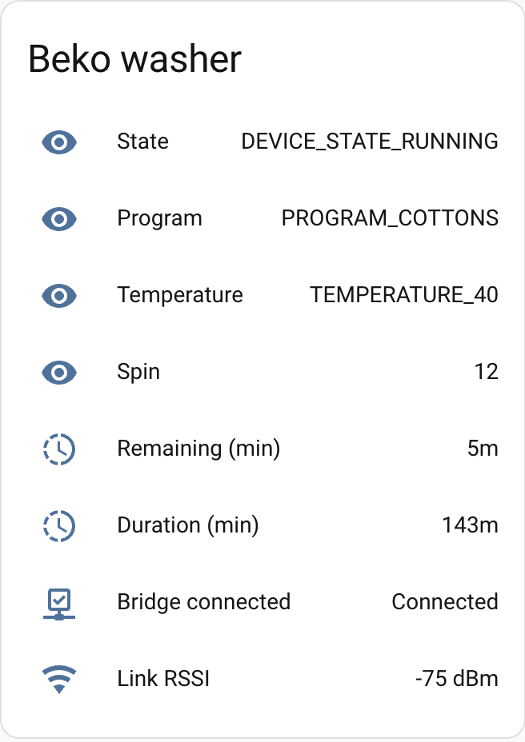

# esphome-homewhiz

[](https://github.com/mateuszsikora/esphome-homewhiz/actions/workflows/ci.yml)
[](LICENSE)

A **local, cloud-free bridge** from HomeWhiz appliances (Beko / Grundig /
Bauknecht / Arçelik) to Home Assistant, running as an [ESPHome](https://esphome.io) external
component on an ESP32 over Bluetooth LE.

No HomeWhiz cloud or phone app at runtime. You log into the cloud **once**, on
your own machine, to download the appliance's data model; after that the ESP32
talks only to the appliance over BLE and only to Home Assistant over your LAN.

> Validated end-to-end on a Beko EWUE7636XAW washing machine: the ESP32 connects,
> handshakes, and publishes 24 entities (state, program, temperature, remaining
> time, warning flags, …) to Home Assistant.



## Why not a Bluetooth proxy?

The usual way to get a HomeWhiz appliance (Beko, Grundig, Bauknecht, Arçelik)
into Home Assistant is the HomeWhiz custom integration over an
ESPHome **Bluetooth proxy**. If you've run that, you may know the symptoms:

- the appliance **drops off Home Assistant every few hours**, back only after you
  power-cycle its Bluetooth *and* reload the integration;
- entities stuck **`unavailable`** right after setup, the Bluetooth icon blinking.

HomeWhiz radios (advertised as `HwZ_…`) allow **one** BLE connection at a time, and a
proxy leaves that connection with no clear owner. **This bridge removes the proxy:**
the ESP32 holds the link itself and rebuilds it in seconds if it drops — Home
Assistant only ever sees live data or a clean "disconnected."

> **The catch is physics, not software:** the appliance's radio is weak and buried
> in metal, so link quality comes down to distance. Mount the ESP32 next to it and
> watch the built-in **Bridge RSSI** sensor — below roughly −80 dBm you'll see
> dropouts.

## Is this for you?

**Use this if** you want a fully local link with no Bluetooth-proxy instability, and
you're fine with a one-time provisioning step plus one ESP32 mounted near the
appliance.

**Stick with the standard HomeWhiz integration if** the proxy path is already stable
for you and you'd rather not add hardware: it needs no dedicated ESP per appliance and
fetches the appliance model from the cloud itself, whereas this bridge has you
generate that model once during provisioning and regenerate it if the appliance
changes.

## Highlights

- **Fully local** — after provisioning, zero internet dependency.
- **Config-driven / appliance-agnostic** — the decoder is a table generated from
  the appliance's own configuration. Point the provisioning tool at a washer,
  dryer, dishwasher, oven, … and you get a working entity set with **no code or
  YAML changes** — just regenerate and reflash.
- **Credentials never leave your machine** — used once during provisioning, never
  written to any artifact, never placed on the ESP.
- **Self-discovering** — the firmware logs nearby BLE devices until it connects,
  so you can find your appliance's MAC without a phone.

## How it works

```
┌────────────────────┐        ┌──────────────────────────┐        ┌───────────────┐
│  Provisioning       │  once  │  ESP32 (ESPHome)          │  BLE   │  HomeWhiz      │
│  (your computer)    │        │  homewhiz component       │◄──────►│  appliance     │
│                     │        │                           │        └───────────────┘
│  login → fetch      │        │  handshake, reassemble,   │
│  config → generate: │  ───▶  │  decode via mapping.h,    │  API   ┌───────────────┐
│  · mapping.h        │  files │  publish entities         │◄──────►│ Home Assistant│
│  · entities.yaml    │        │                           │  LAN   └───────────────┘
└────────────────────┘        └──────────────────────────┘
```

1. **Provisioning (once, on your computer).** `provisioning/` logs into the
   HomeWhiz cloud, downloads the appliance's `ApplianceConfiguration` (byte
   offsets, enum tables, factors — all appliance data comes from the cloud,
   nothing is hardcoded), and generates two artifacts:
   - `esphome/components/homewhiz/mapping.h` — the decode table
   - `esphome/homewhiz_entities.yaml` — one Home Assistant entity per field
2. **Bridge (on the ESP32).** The `homewhiz` component connects over BLE,
   performs the handshake, reassembles the state frame, and decodes it by
   **iterating the generated table** — there are no appliance field names or byte
   offsets in the C++. It publishes the decoded values as ESPHome entities.

## Repository layout

```
provisioning/   host-side: fetch config -> mapping.h + homewhiz_entities.yaml
esphome/        ESPHome external component + generic bridge.yaml
tests/          host-side C++ decode test (no hardware needed)
```

## Requirements

- An **ESP32** board (tested on `esp32dev`). BLE + Wi-Fi coexistence on a single
  radio can be marginal through a metal appliance enclosure — a board with an
  external antenna, placed close to the appliance, is recommended. Run **one ESP
  per appliance**: the component decodes against a single generated table, and
  appliances in different rooms are out of one ESP's BLE range anyway.
- [ESPHome](https://esphome.io) **2026.7.2** (esp-idf framework). See
  [ESPHome version](#esphome-version).
- [uv](https://github.com/astral-sh/uv) for the provisioning Python project
  (or any Python 3.12 environment).
- A HomeWhiz account with the appliance already paired in the phone app.

## Getting started

### 1. Provision (download the appliance model)

```sh
cd provisioning
uv sync
cp .env.example .env          # then fill in HOMEWHIZ_USER / HOMEWHIZ_PASS
uv run python fetch_config.py
```

`fetch_config.py` lists every appliance on your account and, unless you pass
`--model` / `--appliance-id`, prompts you to pick one (or auto-selects if there's
exactly one). It writes both generated artifacts and prints where. Credentials
come from `.env` (or the environment); if `.env` is missing and you're in a
terminal, it prompts.

### 2. Configure secrets

```sh
cd ../esphome
cp secrets.yaml.example secrets.yaml   # then edit
```

Set `wifi_ssid` / `wifi_password`. Leave `appliance_mac` as the placeholder for
now — you'll fill it in step 3. The static-IP entries are optional (see
[Static IP](#static-ip-cross-vlan)).

### 3. Find the appliance's BLE MAC and flash

The first flash must go over **USB serial** (use a data-capable cable):

```sh
esphome run bridge.yaml --device /dev/cu.usbserial-XXXX   # or /dev/ttyUSB0 on Linux
```

While the ESP isn't connected to the appliance it logs nearby devices:

```
[scan] Nearby BLE  00:A0:50:AA:BB:CC  RSSI=-70  name='HwZ_...'
```

HomeWhiz appliances advertise a name starting **`HwZ_`**. Put that MAC into
`secrets.yaml` as `appliance_mac`, then reflash. Once the correct MAC connects,
the scan logging goes quiet automatically.

> **One BLE link only.** The appliance accepts a single BLE connection — make
> sure the HomeWhiz phone app is disconnected, or the ESP won't be able to
> connect.

### 4. Add to Home Assistant

The device exposes the ESPHome API. In Home Assistant, add the **ESPHome**
integration pointing at the device's IP (or `homewhiz-bridge.local` if mDNS
works on your network). All generated entities appear automatically.

## Configuration

`bridge.yaml` is appliance-agnostic — the entity set comes from the generated
`homewhiz_entities.yaml` (pulled in via ESPHome `packages`) and the decode from
`mapping.h`. To support a different appliance: re-run provisioning and reflash;
no edits to `bridge.yaml`.

### Service UUID

The BLE characteristics are the same across all HomeWhiz appliances (notify
`0xAC02`, write `0xAC01`), but the **service** they live under is model-specific.
`bridge.yaml` ships with `0000ac00-0000-1000-8000-00805f9b34fb`, confirmed on the
Beko washer. If yours differs, the component logs an error on connect. On the
first failure after boot, and again on the first failure after a log viewer
starts (`esphome logs`, or opening Logs in the dashboard), it also logs the
appliance's GATT table: every service with its handle range and
characteristics. A viewer that reconnects on its own doesn't trigger it, so
restart it if you missed the table. Pick the service that lists
both `0xAC01` and `0xAC02`. The table prints 16-bit UUIDs as `0xAC00`; in
`service_uuid` write them without the `0x` (`"AC00"`) or in the full form
(`"0000ac00-0000-1000-8000-00805f9b34fb"`). The table is logged as warnings, so
it shows at the default `DEBUG` level (and at `WARN`). ESPHome's own GATT dump
from `ble_client` only appears at `logger: level: VERBOSE`.

A warning `esp_ble_gattc_get_descr_by_char_handle error, status=10` right after
connecting is harmless. It means `ble_client` found no notification descriptor
(CCCD) for `AC02`, so it couldn't enable notifications the standard way. Seen on
a Beko B3WFR572W. The appliance streams state after the handshake anyway.

### Connection status

`bridge.yaml` exposes an optional `connected` binary_sensor (device class
*connectivity*) on the `homewhiz` hub:

```yaml
homewhiz:
  - id: appliance
    service_uuid: "…"
    connected:
      name: "Bridge connected"
```

It is **on** while the ESP is connected and handshaken to the appliance, and
**off** when the link is down — appliance powered off, out of BLE range, or the
HomeWhiz phone app has grabbed the single BLE slot. Use it in Home Assistant to
tell live readings apart from a stale last-known state, since the other entities
keep their last value when the appliance goes away. Delete the `connected:` block
to drop the entity.

### What updates, and when

The appliance streams its full state, but each entity only changes when its value
does. **Runtime** fields — `state`, `substate`, `remaining`, `duration` — move as a
cycle progresses. **Configuration** fields — `programme`, `temperature`, `spin`, and
the option flags — stay put until you change that setting on the appliance itself.
So an idle machine shows a static snapshot of its last-selected settings — that's
expected, not a stuck entity.

### Exposing numeric fields (spin, temperature)

Some fields — notably `WASHER_SPIN` — are modelled in the appliance config as an
enum with only a few landmark values (`no_spin`, `rinse_hold`), even though the
byte is really numeric. By default they decode as text: a recognised landmark
publishes its name, and any other value falls back to the raw number (e.g.
`"12"`) rather than going stale. To expose such a field as a proper numeric
sensor, add a `sensor` for the same `key` with a `factor` — the reading becomes
`(raw byte) * factor`:

```yaml
sensor:
  - platform: homewhiz
    homewhiz_id: appliance
    key: WASHER_SPIN
    name: "Spin speed"
    factor: 100          # byte 12 -> 1200 rpm
    unit_of_measurement: rpm
```

### Static IP (cross-VLAN)

If Home Assistant or your dev machine is on a **different VLAN** than the ESP,
mDNS (`.local` resolution) won't work — multicast doesn't cross VLANs. Set a
static IP so OTA and log streaming reach the device by unicast: fill `static_ip`
/ `gateway` / `subnet` in `secrets.yaml`. For a single-VLAN network you can
delete the `manual_ip:` block from `bridge.yaml` and use DHCP.

### Writing to the appliance (advanced, opt-in)

The bridge does not write to the appliance unless you explicitly call the
`send_command(index, value)` Home Assistant action that ships in `bridge.yaml`
(plan §3.6). The action is present out of the box but **never fires on its own** —
you invoke it deliberately. Remove the `actions:` block from `bridge.yaml` to make
the bridge strictly read-only.

> ⚠️ **Writes can physically operate the appliance** (e.g. start a wash cycle).
> The command values are **appliance-specific and not validated by this project**.
> Test with care, and never enable this where an unattended start could cause
> harm or flooding. Remove the `actions:` block from `bridge.yaml` to make the
> bridge strictly read-only.

The writable target is the **device-state index** (`STATE`, index 34 on the
washer — `program.wfaWriteIndex` is null in every known config, so you cannot set
a program directly). The state enum values are in your generated `mapping.h`,
e.g. `10=on, 20=off, 30=running, 40=paused, 60=delay`. Which value triggers which
transition is firmware-specific — **verify on your own device.**

Call it from Home Assistant (entity id derived from the device name):

```yaml
# Example HA service call — values are illustrative, verify on your device.
action: esphome.homewhiz_bridge_send_command
data:
  index: 34
  value: 40      # e.g. attempt "paused"
```

Or wire a template button:

```yaml
button:
  - platform: template
    name: "Washer Pause"
    on_press:
      - lambda: 'id(appliance)->send_command_key("STATE", 40);'
```

## ESPHome version

Pinned target: **ESPHome 2026.7.2** (esp-idf). `esphome compile bridge.yaml`
builds cleanly against it (~60% flash on `esp32dev`), and CI compiles the firmware
on every push, so a change that breaks the build against this pin is caught before
merge. CI won't flag a *newer* ESPHome release on its own — bump the pin and let it
rebuild to validate one. The component uses low-level BLE GATT accessors (`get_gattc_if`,
`get_conn_id`, `get_remote_bda`, `get_characteristic`) that can drift across
releases; if a build fails on a newer version, adjust those names — the decode
logic is unchanged.

## Known limitations

- **Write commands are unvalidated.** The opt-in `send_command` action (see
  [Writing to the appliance](#writing-to-the-appliance-advanced-opt-in)) can
  physically operate the appliance, and its command values are appliance-specific
  and **not validated by this project**. Invoke it deliberately, or remove the
  `actions:` block from `bridge.yaml` for a strictly read-only bridge.
- **State frames spanning more than two BLE fragments aren't reassembled.** The
  HomeWhiz state frame is exactly two fragments — this matches upstream, and there
  is no total-count field in the header to reassemble more. A frame carrying a
  third fragment is dropped and logged with a loud `WARNING` rather than silently
  truncated. Not observed on any known appliance; if you hit it, please open an
  issue with your model.
- **Door-open flag may not track.** On the appliance this was built against (Beko
  EWUE7636XAW), the `door_is_open` binary_sensor stays `off` even with the door
  physically open. It may reflect the door **lock** during a cycle rather than the
  physical door, or the bit may differ per model — one data point isn't enough to
  tell. If yours behaves differently, a note (model + whether the flag tracks) in an
  issue helps.
- **Air conditioners (roadmap).** AC units map onto Home Assistant's `climate`
  domain rather than `sensor`/`text_sensor`, so they aren't covered by the generic
  entity set yet. A `climate` platform would be a natural follow-up.

## Development

```sh
# generator + provisioning logic (no hardware)
cd provisioning && uv run pytest

# C++ decode + fragment reassembly against a known-good frame (no hardware)
bash tests/run.sh
```

The decode core (`esphome/components/homewhiz/decode.h`) is deliberately free of
any ESPHome/ESP-IDF dependency so it can be unit-tested on the host.

CI runs both of the above and then `esphome config` against **every** fixture in
`provisioning/tests/fixtures/` (washer/dryer/dishwasher/oven), so a generator
change that breaks an appliance shape the washer doesn't exercise is caught
without hardware.

## Security

- HomeWhiz credentials are used **only** during provisioning, on your machine,
  read from `.env` or a prompt. They are never written to any generated file,
  committed, or placed on the ESP.
- `secrets.yaml` and `.env` are git-ignored; `*.example` templates are provided.
- The ESP holds only the anonymous offset/enum table — no account data.

## Credits

- Protocol facts, auth flow, and the vendored `api.py` / `appliance_config.py`
  come from the excellent
  [home-assistant-HomeWhiz](https://github.com/home-assistant-HomeWhiz/home-assistant-HomeWhiz)
  project (MIT).

## License

[MIT](LICENSE). Vendored upstream files are MIT — see
`provisioning/vendor/LICENSE.upstream`.
